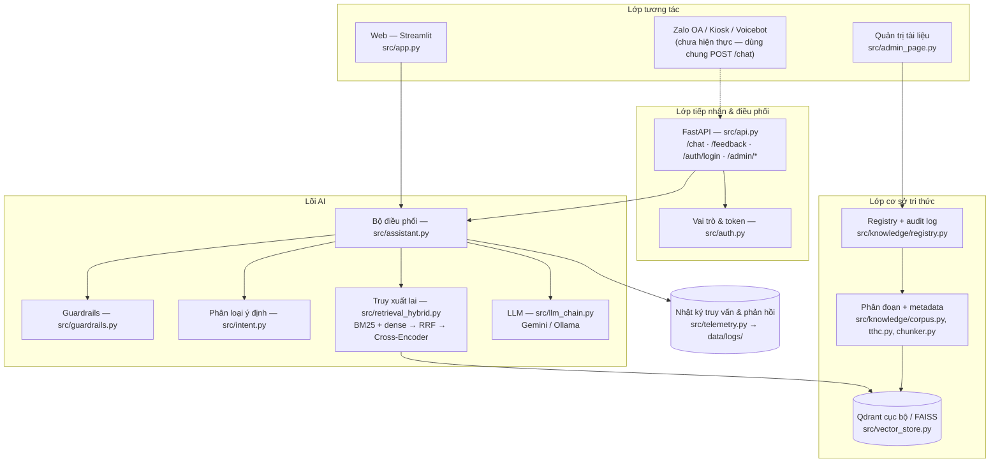

# Kiến trúc hiện thực — Trợ lý ảo hỗ trợ chính quyền địa phương cấp cơ sở

Tài liệu này đối chiếu thiết kế ở Chương 2 của báo cáo giữa kỳ (`DACN_GiuaKy.docx`) với mã nguồn: mỗi yêu cầu,
quy tắc nghiệp vụ được hiện thực ở đâu, kiểm thử bằng gì, và phần nào **chưa** làm. Dùng làm căn cứ viết Chương 3.

---

## 1. Kiến trúc phân lớp (mục 2.2.1)

Trong nguyên mẫu, các dịch vụ chạy trong cùng một tiến trình Python (Streamlit hoặc FastAPI), nhưng ranh giới
module và hợp đồng dữ liệu được giữ như thiết kế (mục 2.2.1 c), nên có thể tách thành dịch vụ riêng sau này.

## 2. Luồng xử lý một câu hỏi (mục 2.2.2 i)

`VirtualAssistant.answer()` hiện thực đúng mã giả `answer_question` của báo cáo:

| Bước | Mã giả | Hiện thực |
|:--|:--|:--|
| 1 | `validate_and_normalize` | `guardrails.check_input`: chuẩn hóa Unicode NFC, giới hạn 1.000 ký tự, che số định danh / số điện thoại / email (BR-07) |
| 2 | (nhánh ngoại lệ) | lời chào → `small_talk`; người dân hỏi tài liệu nội bộ → `access_denied`; câu hỏi thiếu dữ kiện → `needs_clarification` kèm gợi ý thủ tục (FR-11, UC-05) |
| 3 | `resolve_access_scope` | `UserContext.scopes` lấy từ vai trò đã xác thực (`auth.py`), không nhận từ client |
| 4 | chuẩn hóa truy vấn | `legal_glossary.apply_glossary` (từ đời thường → thuật ngữ, vd. "làm lại giấy khai sinh" → "đăng ký lại khai sinh") + LLM viết lại khi cần |
| 5 | phân loại ý định | `intent.classify_intent` — nhãn của Vi-CommuneQA: tra cứu hồ sơ / lệ phí / thời gian / điều kiện / căn cứ pháp lý / trình tự |
| 6 | `sparse_search`, `dense_search` | BM25 (`rank_bm25`, tách từ giữ dấu và số hiệu) + Qdrant; **cả hai** lọc `SearchFilter` (quyền, hiệu lực, phần bị thay thế) trước khi hợp nhất |
| 7 | `reciprocal_rank_fusion` | `RRF(d) = Σ 1/(k₀ + rᵢ(d))`, k₀ = 60 (`FUSION_METHOD=weighted` giữ cách cộng điểm cũ để so sánh) |
| 8 | `deduplicate_and_limit` | khử trùng nội dung, tối đa 5 đoạn mỗi văn bản / mỗi thủ tục |
| 9 | `rerank` | Cross-Encoder `mmarco-mMiniLMv2-L12-H384-v1`; cộng điểm cho đoạn đúng mục được hỏi (ý định) và thủ tục có tên khớp câu hỏi (FR-07); đưa mục được hỏi của thủ tục đứng đầu vào nhóm ứng viên (mở rộng đoạn cùng thủ tục, mục 2.3.1 d) |
| 10 | `evidence_is_insufficient` | điểm Cross-Encoder cao nhất < `MIN_RELEVANCE_SCORE` (−4,0) → `insufficient_evidence`, không gọi LLM |
| 11 | `generate_answer` | prompt tách vùng NGUỒN (dữ liệu, không phải chỉ dẫn); mỗi ý phải gắn mã `[S#]`; không đủ căn cứ thì trả "KHÔNG ĐỦ CĂN CỨ" |
| 12 | `validate_answer_and_citations` | `guardrails.check_citations`: mã `[S#]` phải tồn tại; mọi "Điều N" và số hiệu văn bản trong câu trả lời phải có trong ngữ cảnh |
| 13 | `regenerate_once_with_constraints` | sinh lại **một** lần kèm danh sách lỗi |
| 14 | `safe_fallback_with_correlation_id` | vẫn lỗi → `insufficient_evidence` + mã tra cứu; các đoạn đã tìm chỉ hiện là "tài liệu có liên quan" |
| 15 | `format_answer_with_sources` | `sources` = chỉ các nguồn **được trích**; `related_sources` = phần còn lại (mục 2.3.2 i); lưu ý của văn bản (bị thay thế một phần, dữ liệu mẫu...) |

Trạng thái trả về (Bảng 2.14, mục 2.2.4): `answered_with_sources`, `needs_clarification`, `insufficient_evidence`,
`access_denied`, `service_unavailable`, `invalid_request`, `small_talk`.

## 3. Đối chiếu yêu cầu với hiện thực

### 3.1 Yêu cầu chức năng (Bảng 2.2, 2.3)

| Mã | Chức năng | Trạng thái | Hiện thực | Kiểm thử |
|:--|:--|:--:|:--|:--|
| FR-01 | Tiếp nhận câu hỏi, cấp mã yêu cầu | ✅ | `guardrails.check_input`, `correlation_id` dạng `req-…` | `test_guardrails`, `test_assistant` |
| FR-02 | Tra cứu TTHC | ✅ | 32 TTHC cấp xã, chunk theo nhóm mục (`knowledge/tthc.py`) | `test_tthc`, benchmark |
| FR-03 | Hướng dẫn biểu mẫu | ◐ | mục "Mẫu đơn, mẫu tờ khai" có trong chunk thời hạn – lệ phí; **chưa** có liên kết tải biểu mẫu đã xác minh | — |
| FR-04 | Tra cứu VBQPPL | ✅ | 10 văn bản, chunk theo Điều / khoản (`chunker.py`) | `test_chunker` |
| FR-05 | Tra cứu tài liệu nội bộ | ✅ | `access_scope=internal`, chỉ vai trò cán bộ / quản trị | `test_filters`, `test_api`, benchmark |
| FR-06 | Tìm kiếm lai | ✅ | BM25 + Qdrant + RRF | `test_retrieval` |
| FR-07 | Xếp hạng lại | ✅ | Cross-Encoder + tín hiệu ý định / tên thủ tục | `test_retrieval` |
| FR-08 | Sinh câu trả lời có căn cứ | ✅ | `assistant.ANSWER_PROMPT` | `test_assistant` |
| FR-09 | Hiển thị trích dẫn | ✅ | thẻ nguồn: tên, số hiệu, vị trí, trạng thái hiệu lực, đoạn trích, liên kết | `test_api` |
| FR-10 | Hội thoại nhiều lượt | ✅ | 5 lượt gần nhất (đã che dữ liệu cá nhân) | `test_guardrails` |
| FR-11 | Yêu cầu làm rõ | ✅ | `needs_clarification` + nút gợi ý | `test_guardrails`, benchmark |
| FR-12 | Từ chối khi thiếu căn cứ | ✅ | cổng điểm + "KHÔNG ĐỦ CĂN CỨ" + kiểm tra trích dẫn | `test_assistant`, benchmark |
| FR-13 | Phản hồi chất lượng | ✅ | 👍/👎 + lý do (Streamlit), `POST /feedback` | `test_api`, `test_evaluation_metrics` |
| FR-14 | Quản lý tài liệu | ✅ | registry: nạp → chờ kiểm tra → duyệt → đánh chỉ mục → rút / thay thế | `test_registry` |
| FR-15 | Quản lý hiệu lực | ✅ | `effective_from/to`, `legal_status`, quan hệ `supersedes` / `superseded_by`, lọc theo mốc `as_of` | `test_filters`, `test_registry` |
| FR-16 | Theo dõi truy vấn | ✅ | `data/logs/requests.jsonl`: mã, trạng thái, đoạn đã dùng, độ trễ từng bước, phiên bản pipeline; câu hỏi chỉ lưu băm SHA-256 | `test_evaluation_metrics` |
| FR-17 | Kênh Web | ✅ | `src/app.py` | chạy thử thủ công |
| FR-18 | Adapter Zalo OA | ⏳ | chưa hiện thực; API đã nhận `channel="zalo"` | — |
| FR-19 | Kiosk | ⏳ | chưa có giao diện riêng; đã có nút "Cuộc trò chuyện mới" xóa phiên | — |
| FR-20 | Voicebot | ⏳ | chưa hiện thực (STT/TTS) | — |
| FR-21 | Giám sát quản trị | ✅ | tab "Giám sát": số lượt, P50/P95, tỷ lệ chưa đủ căn cứ, phản hồi; `GET /admin/metrics` | `test_evaluation_metrics` |
| FR-22 | Xuất báo cáo thử nghiệm | ✅ | `evaluation/run_benchmark.py` → `evaluation/results_benchmark_*.json` | `test_evaluation_metrics` |

### 3.2 Quy tắc nghiệp vụ (Bảng 2.4, 2.5)

| Mã | Hiện thực |
|:--|:--|
| BR-01 | Chỉ tài liệu `approved` / `indexed` vào chỉ mục (`schema.SERVABLE_STATUSES`); tài liệu tải lên mặc định `needs_review` |
| BR-02 | Thông tin nguồn lấy từ metadata (`assistant.source_card`); số Điều / số hiệu không có trong ngữ cảnh bị chặn (`check_citations`) |
| BR-03 | `SearchFilter`: loại văn bản chưa / hết hiệu lực và phần bị thay thế (Chương II NĐ 100/2019 từ 01/01/2025) |
| BR-04 | Lọc `access_scope` trong truy vấn BM25 và Qdrant, trước khi dựng ngữ cảnh; API tự kiểm tra quyền quản trị |
| BR-05 | `insufficient_evidence` với hướng dẫn kênh có thẩm quyền; không khẳng định "không có quy định" |
| BR-06 | Lời nhắc trên giao diện: chỉ hỗ trợ tra cứu, không thay thế quyết định của cán bộ |
| BR-07 | `mask_pii` trước khi gửi LLM, Langfuse và ghi log |
| BR-08 | `data/registry/audit_log.jsonl`: người thực hiện, thời gian, trạng thái cũ / mới |
| BR-09 | Chỉ hiển thị `source_url` do quản trị viên lưu; không sinh URL |
| BR-10 | Tham số `as_of` (API) lọc theo mốc thời gian; phần bị thay thế được tìm lại khi hỏi về thời điểm trước đó |

### 3.3 Yêu cầu phi chức năng (Bảng 2.6, 2.7)

| Mã | Mục tiêu | Cách đo trong repo |
|:--|:--|:--|
| NFR-01 | Recall@5 ≥ 90% | `run_benchmark.py` (Recall@5, Precision@3, MRR@10, NDCG@5) |
| NFR-02 | Trích dẫn chính xác ≥ 95% | `citation_gold_rate` (câu trả lời trích đúng đoạn chuẩn) + `check_citations` khi chạy |
| NFR-03 | P95 truy xuất < 1 s | `latency_ms.sparse/dense/fusion/rerank` — **chưa đạt** trên máy thử (xem mục 6) |
| NFR-04 | Đầu-cuối < 5 s | `latency_ms.total_ms` |
| NFR-05 | Chịu tải 100 người dùng | **chưa kiểm thử** |
| NFR-06 | Không truy xuất chéo quyền | `test_filters` (ma trận vai trò – tài liệu, cả bộ lọc Python và Qdrant), `access_leaks` trong benchmark |
| NFR-07 | ROUGE / BLEU / BERTScore / RAGAS | `evaluation/generation_metrics.py`; RAGAS qua `evaluation/evaluate_finetuned.py` (giao diện `invoke()` cũ) |
| NFR-08 | Khả năng sử dụng (CSAT / UTAUT2) | **chưa khảo sát** |
| NFR-09 | Truy vết | `correlation_id`, `pipeline_version`, `corpus_version`, mô hình embedding / LLM trong log |
| NFR-10 | Tính cập nhật | registry + `corpus_version` đổi → chỉ mục dựng lại; `test_registry` |

## 4. Cơ sở tri thức (mục 2.3)

### 4.1 Mô hình dữ liệu

`DocumentRecord` (`src/knowledge/schema.py`) gộp *Document* + *DocumentVersion* của mô hình logic; *Chunk* là
`Document` của LangChain kèm metadata; *EmbeddingRecord* là điểm Qdrant (id = `chunk_id`); *IngestionJob* được
ghi trong audit log và manifest chỉ mục. Hai loại trạng thái được tách riêng:

- `status` (quy trình): `received → needs_review → approved → indexed → superseded / withdrawn`, chuyển trạng thái
  kiểm tra theo `ALLOWED_TRANSITIONS`.
- `legal_status` (hiệu lực): `verified_current`, `unverified`, `amended`, `partially_superseded`, `superseded`,
  `expired`. Tài liệu được duyệt vào kho vẫn có thể "chưa xác minh hiệu lực" và giao diện hiển thị đúng như vậy.

Metadata của mỗi chunk: `chunk_id` (UUID5 ổn định theo phiên bản + thứ tự, nên nạp lại không tạo bản trùng), `document_id`,
`version_id`, `title`, `document_number`, `document_type`, `article_reference`, `effective_from/to` (và dạng số để
lọc), `legal_status`, `access_scope`, `source_url`, `superseded(_from)`; với TTHC thêm `procedure_id`,
`procedure_title`, `procedure_field`.

### 4.2 Dữ liệu hiện có

| Thành phần | Quy mô **thực tế** trong repo | Nguồn | Ghi chú |
|:--|:--|:--|:--|
| VBQPPL | 10 văn bản (`data/raw/`) | Dự án gốc | Số hiệu, ngày ban hành, ngày hiệu lực lấy từ chính văn bản (`knowledge/catalog.py`) |
| TTHC cấp xã | 32 thủ tục: hộ tịch 18, chứng thực 11, nuôi con nuôi 3 (`data/tthc/haiphong_tthc_cap_xa.json`) | Văn bản công bố TTHC cấp xã trên Cổng TTĐT TP. Hải Phòng (`data/tthc/sources/`) | **Dữ liệu mẫu**, `unverified`: căn cứ pháp lý chưa nêu NĐ 120/2025/NĐ-CP (chính quyền hai cấp); chưa có mã TTHC |
| Tài liệu nội bộ | 1 tài liệu **giả lập** (`data/internal/`) | Nhóm tự soạn | Chỉ để kiểm thử phân quyền |
| Benchmark | 23 câu (`data/benchmark/vi_communeqa_sample.jsonl`) | Soạn từ dữ liệu trên; câu luật lấy đáp án từ `golden_set.json` | Mẫu theo định dạng Vi-CommuneQA, cần rà soát |

> Báo cáo Chương 1 nêu quy mô 1.250 TTHC, 350 VBQPPL, 520 câu benchmark. Repo **chưa** có bộ dữ liệu đó. Khi viết
> Chương 3, cần ghi đúng quy mô thực tế đã dùng để đo, hoặc bổ sung dữ liệu trước khi báo cáo kết quả.

Thêm TTHC của tỉnh khác: `python -m src.knowledge.build_tthc <văn bản công bố.pdf> --out data/tthc/<tên>.json
--source-url <URL>`, rồi nạp tệp JSON ở trang quản trị (loại "Thủ tục hành chính"). Parser nhận diện tiêu đề mục
sau khi bỏ khoảng trắng và ghép âm tiết bị tách khi trích PDF bằng từ điển âm tiết lấy từ văn bản luật sạch.

### 4.3 Chỉ mục

`vector_store.QdrantKnowledgeStore` (Qdrant chế độ cục bộ, `qdrant_data/`): mỗi phiên bản kho
(`corpus_version`) dựng vào một collection mới, kiểm tra số điểm rồi mới chuyển manifest sang collection đó và xóa
bản cũ (mục 2.3.2 e). Vector của nội dung không đổi được dùng lại, nên duyệt thêm một tài liệu chỉ phải embed phần mới.
Lần đầu dựng lấy 3.833 vector từ `faiss_index_local/` sau khi kiểm tra đúng mô hình (cosine ≥ 0,99) và chỉ embed
280 đoạn mới (≈ 80 s trên CPU). `VECTOR_BACKEND=faiss` dùng FAISS trong bộ nhớ, dựng từ cùng vector, làm phương
án so sánh (Bảng 2.11, 2.12). Tên collection gồm khóa mô hình embedding, nên vector của E5 và BGE-M3 không bao giờ bị trộn.

## 5. Phân quyền (Bảng 2.1)

| Vai trò | Đăng nhập | Phạm vi dữ liệu | Quản trị |
|:--|:--|:--|:--|
| Người dân (`citizen`) | không cần | `public` | không |
| Cán bộ (`officer`) | tài khoản cục bộ | `public`, `internal` | không |
| Quản trị tri thức (`admin`) | tài khoản cục bộ | `public`, `internal` | có |

Tài khoản: `python -m src.auth add-user <tên> officer|admin` (mật khẩu PBKDF2-SHA256 trong
`data/registry/users.json`, không commit). Token API ký HMAC-SHA256 bằng `APP_SECRET`, hết hạn sau 8 giờ.

## 6. Kết quả đo hiện tại

Xem `README.md` (mục "Đánh giá") và các tệp `evaluation/results_benchmark*.json`. Mỗi tệp ghi kèm cấu hình pipeline
(mô hình embedding, phương pháp hợp nhất, LLM, phiên bản kho) để tái lập.

## 7. Kế thừa từ dự án gốc

Dự án xây trên [Leanhoangy/vietnamese-rag-chatbot](https://github.com/Leanhoangy/vietnamese-rag-chatbot) (MIT).
Những phần giữ nguyên: chunker theo Điều / khoản cho văn bản luật, hai mô hình embedding, dữ liệu huấn luyện,
bộ đánh giá RAGAS và golden set.

### 7.1 Mô hình embedding

- **Fine-tuned multilingual-e5-base** (mặc định, `Hoangy2005/vietnamese-legal-embedder` trên Hugging Face):
  278 triệu tham số, 768 chiều, `TripletLoss` (margin 0,5) trên 3.642 triplet văn bản luật với hard negative từ
  FAISS (`training/`). Mô hình được fine-tune trên văn bản luật nên phân biệt các TTHC kém: các đoạn TTHC có độ tương đồng
  cosine với câu hỏi đều quanh 0,92–0,95. BM25 và Cross-Encoder bù phần này; nên so sánh với BGE-M3
  (`EMBEDDING_MODEL=bge-m3`) trên benchmark.
- **Custom Transformer** (`src/custom_transformer/`): 738.560 tham số, 128 chiều, tự xây tokenizer, kiến trúc và
  vòng lặp huấn luyện (`EMBEDDING_MODEL=custom`).

### 7.2 Lỗi đã gặp và cách sửa

| Triệu chứng | Nguyên nhân gốc | Cách sửa |
|---|---|---|
| Hỏi "vượt đèn đỏ" nhưng trả lời theo Điều 47 (đường ngang đường sắt) | Cụm "đèn đỏ" chỉ xuất hiện nguyên văn ở Điều 47 | Từ điển thuật ngữ + LLM viết lại câu hỏi |
| Mức phạt xe đạp sai | Overlap của splitter tách điểm đ) khỏi dòng "2. Phạt tiền…" | Chunk theo khoản, không cắt ngang khoản |
| Câu trả lời thiếu xe máy | Top-7 cố định | k thích ứng theo điểm cross-encoder |
| Trích dẫn "Điều 73" không tồn tại | Regex tách cả câu dẫn chiếu giữa dòng | Neo regex ở đầu dòng |
| Trả lời mức phạt giao thông đã hết hiệu lực | NĐ 100/2019 và NĐ 168/2024 có nhiều điều gần giống nhau | Gắn cờ `superseded` cho Chương II NĐ 100 và lọc ngay từ bước lấy ứng viên |
| Mức trừ điểm GPLX nằm khác chunk với hành vi | Mức trừ điểm ghi ở khoản riêng | Gắn "[Bị trừ … điểm]" vào dòng của từng hành vi khi chunk |
| *(mới)* Hỏi "cần giấy tờ gì" nhưng ra mục "Trình tự" | Mục trình tự dài, lặp từ "giấy tờ"; cả 32 TTHC chung một `document_id` nên giới hạn 5 đoạn / văn bản chặn ứng viên | Giới hạn theo từng thủ tục; phân loại ý định → mở rộng mục được hỏi + điểm cộng |
| *(mới)* Hỏi "đăng ký kết hôn" nhưng ra "kết hôn lưu động" | Cross-Encoder không phân biệt biến thể thủ tục | Điểm cộng theo tỷ lệ từ của tên thủ tục có trong câu hỏi |
| *(mới)* Tên tệp `Nghidinh 100:2019.docx` không checkout được trên Windows | Dấu `:` không hợp lệ trong tên tệp Windows | Đổi thành `Nghidinh 100-2019.docx` |

## 8. Hạn chế và việc tiếp theo

- **Dữ liệu**: mới có 32 TTHC mẫu của một tỉnh, chưa xác minh hiệu lực sau NĐ 120/2025; chưa có mã TTHC, liên kết
  biểu mẫu, quyết định phân cấp của UBND TP.HCM như phạm vi báo cáo.
- **Độ trễ**: Cross-Encoder trên CPU chiếm phần lớn thời gian truy xuất (P95 vài giây, chưa đạt mục tiêu < 1 s).
  Hướng xử lý: giảm `RERANK_POOL`, chạy GPU, hoặc so sánh cấu hình không rerank trên benchmark (Bảng 2.9).
- **LLM cục bộ**: `llama3.1:8b` đôi khi đọc nhầm điều luật hoặc bỏ mã `[S#]`; lớp kiểm tra trích dẫn chặn được lỗi
  hình thức nhưng không kiểm được mọi sai lệch nội dung. Nên dùng `qwen3:8b` hoặc Gemini và báo cáo RAGAS Faithfulness.
- **Qdrant cục bộ** chỉ cho một tiến trình mở `qdrant_data/`: chạy Streamlit và API cùng lúc cần Qdrant server
  (`QDRANT_URL`).
- **Chưa làm**: adapter Zalo OA, kiosk, voicebot (FR-18–20); kiểm thử tải (NFR-05); khảo sát CSAT / UTAUT2 (NFR-08);
  phân loại ý định bằng học máy (hiện là quy tắc từ khóa).
